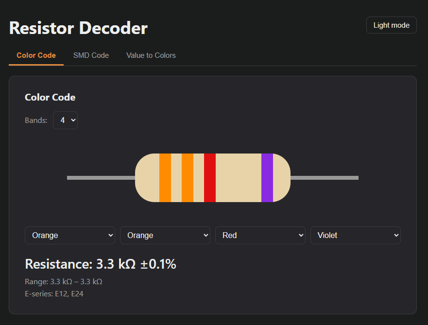
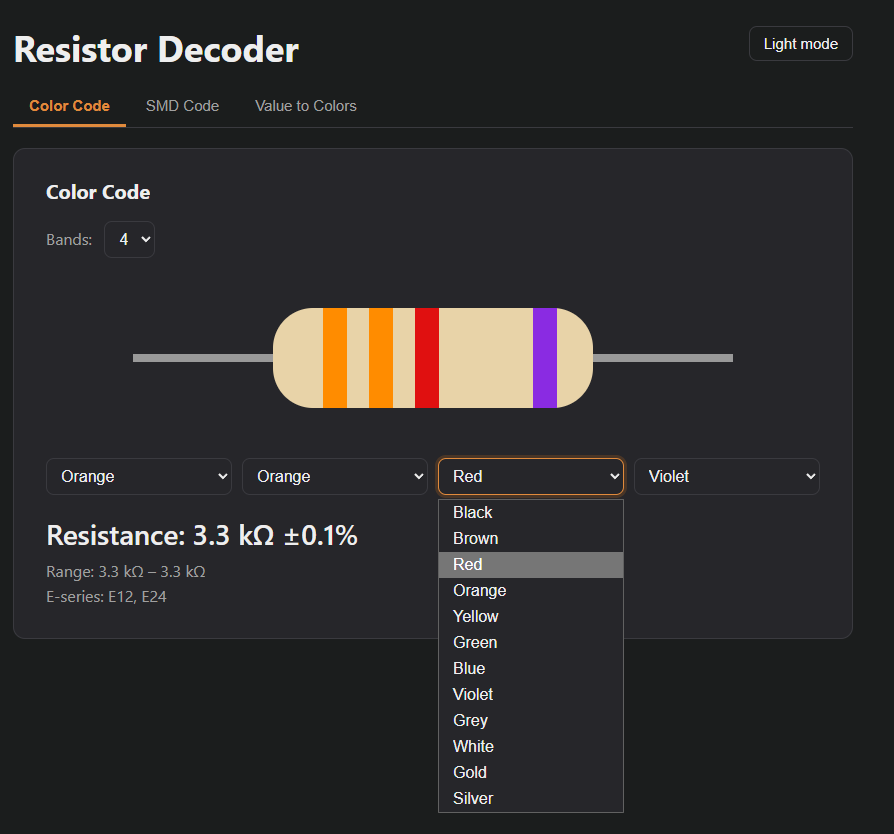
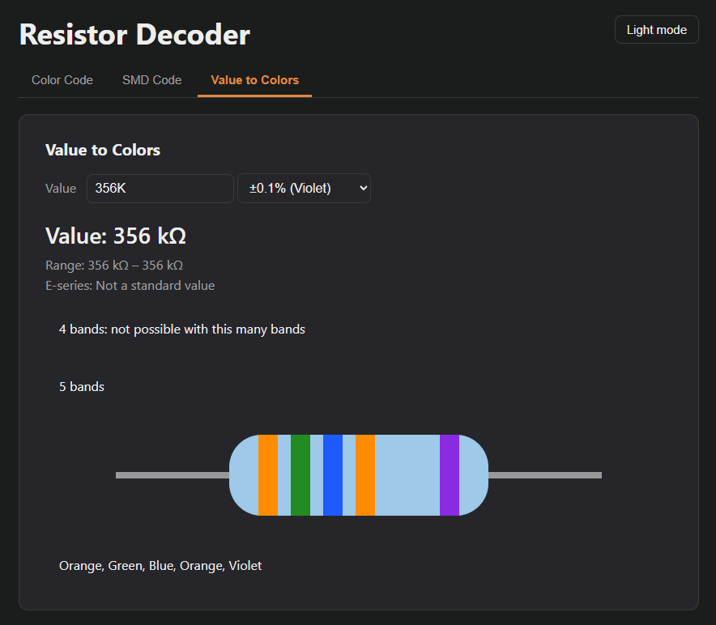
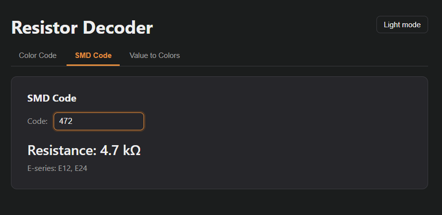

# Resistor decoder 
A web tool for electronics hobbyists that decodes resistor values from color bands and SMD codes, and works the other way too- type a value and see which bands to look for.
It´s usefull when you find a resistor with a color code and don´t have a multimeter on hand: you just compare the colors and immediately read the value, tolerance, and actual range, and it also works the other way around, from value to colors.
Built with plain HTML, CSS and JavaScript. No frameworks, no build step.
##Usage

When you open index.html in your browser, you´ll land on the Color Code tab with a drawing of a resistor. Above it, in the top-left corner, you can choose how many bands your resitor has (4,5 or 6). Then pick the color of each band from the dropdowns, and the drawing and the result update instantly.

The Value to Colors tab works the other way around. Type the value you need, for example `4.7k`, and choose the tolerance from the dropdown. You'll see drawings of both a 4-band and a 5-band resistor with the correct colors and their names, plus the actual range and the E-series. It's handy when you're sorting a box of resistors and looking for a specific value.

The SMD Code tab is for small surface-mount resistors that use a printed code instead of color bands. Type the code from the resistor into the box and the value appears right away, along with the E-series it belongs to. It understands 3-digit codes like `472`, 4-digit codes like `1002`, R notation like `4R7` or `R10`, and EIA-96 precision codes like `01C` or `68B`.
## How to run 
### Hosted instance 
- [Link!](https://kylda-007.github.io/resistor-decoder)
### Local hosting 
Clone the repository. Open `index.html` in your browser or setup a static web server.